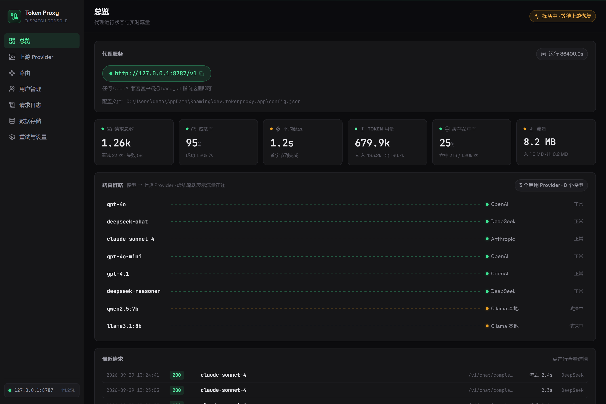
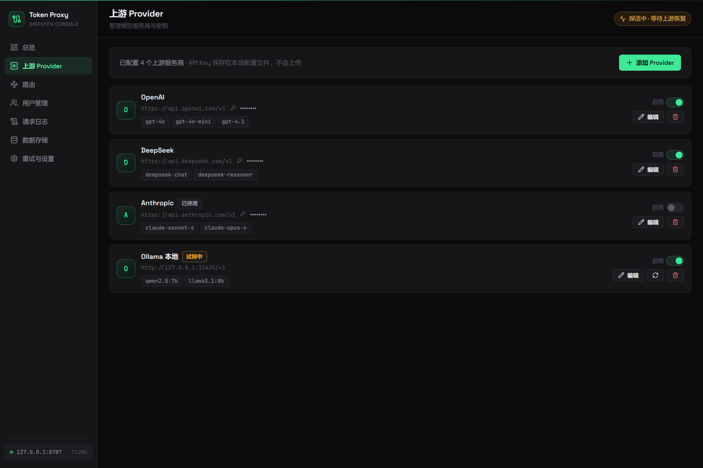
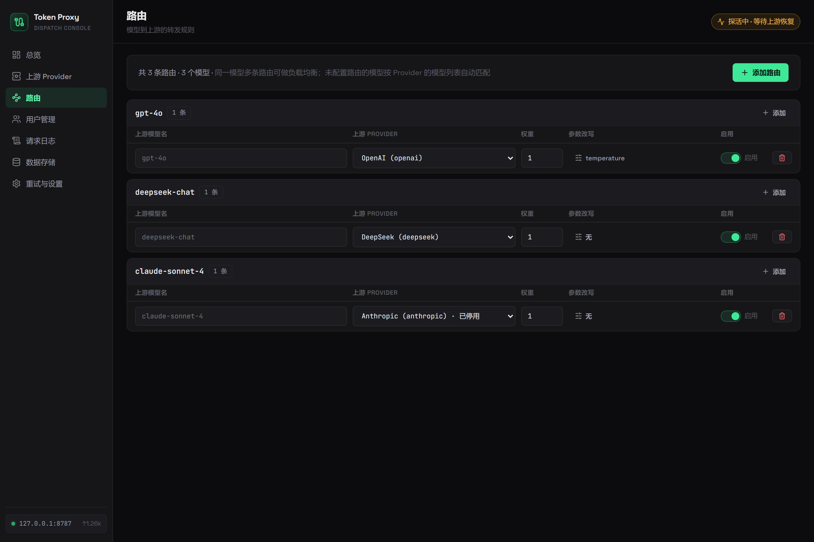
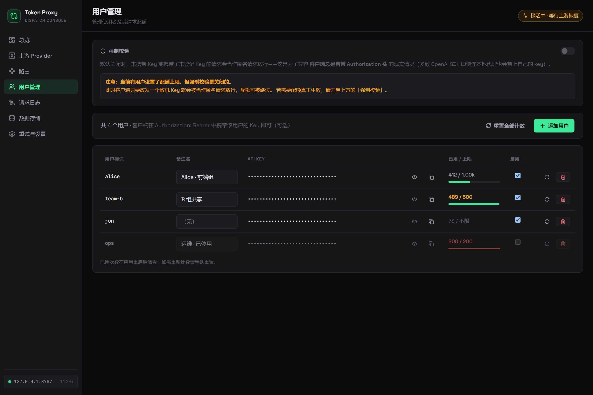
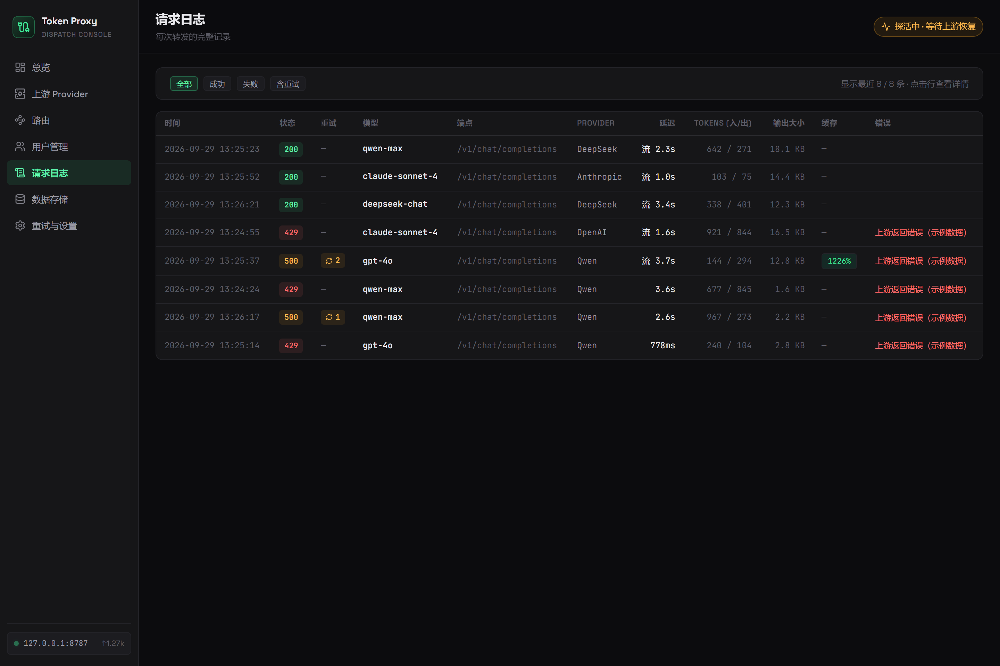
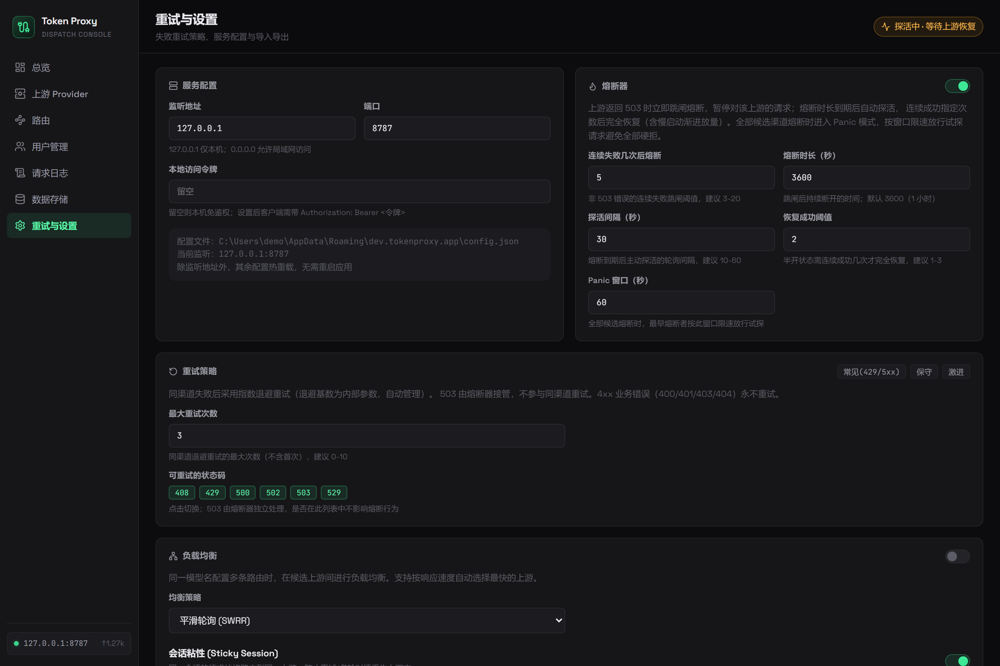

# Token Proxy

本地 OpenAI 兼容模型代理 + 桌面控制台（Tauri 2 + Rust/Axum + React）。

把任意 OpenAI 兼容客户端（Cherry Studio、Cline、自研代码等）的 `base_url`
指向 `http://127.0.0.1:8787/v1`，由本应用负责：**路由到多上游、失败自动重试
（指数退避 + 熔断）、SSE 流式透传、参数改写、请求统计**。

## 功能

- OpenAI 兼容 API：`/v1/models`、`/v1/chat/completions`、`/v1/completions`、
  `/v1/embeddings`、`/v1/responses`，其余 `/v1/*` 透传
- **Claude Code / Codex 兼容层**：`/v1/messages`（Anthropic 协议）、
  `/v1/responses`（OpenAI Responses 协议）协议翻译，请求模型可兜底映射到代理已配置的模型
- SSE 流式（`stream: true`）逐行转发，断流返回错误事件，自动统计 token 用量
- 失败重试：可配置重试次数/退避/可重试状态码；网络错误、429、5xx 自动重试，
  4xx 业务错误不重试；指数退避 + 抖动
- 熔断器：上游连续失败达阈值后熔断冷却，半开试探自动恢复（每 Provider 独立）
- 多 Provider + 路由表：模型 → 上游映射，支持参数改写（temperature/max_tokens 等）
- 配置热重载：修改配置文件即时生效，无需重启
- 桌面 GUI：总览 / 上游 Provider / 路由 / 用户管理 / 请求日志 / 重试与设置六个页面，
  实时请求流、路由链路图、熔断状态展示
- **用户与配额**：为每个 API Key 设定请求上限（`max_requests`，不填=不限），
  原子计数、超额拒绝、可单独启停；用量存内存，重启清零
- 本地鉴权：可选的 `local_api_key`，默认仅本机可访问

## 界面预览

| 总览 | 上游 Provider |
|---|---|
|  |  |

| 路由 | 用户管理 |
|---|---|
|  |  |

| 请求日志 | 重试与设置 |
|---|---|
|  |  |

> 截图为 mock 数据驱动（`npm run build && npm run preview`）下的界面快照。

## 开发

```bash
# 前置：Rust 1.77+、Node 18+、Windows 需 WebView2（Win10/11 自带）

npm install
npm run tauri dev      # 开发模式（vite + cargo 热重载）
npm run tauri build    # 打包安装程序
```

**纯前端预览**（不需要 Tauri 环境，mock 数据驱动）：

```bash
npm run build && npm run preview
# 打开 http://localhost:4173 —— 非 Tauri 环境自动注入示例数据
```

**测试**：

```bash
# 代理核心：单元测试 + 端到端冒烟（转发/流式/重试/熔断，内置 mock 上游）
cd src-tauri/proxy-core && cargo test
```

## 架构

```
src-tauri/
├── proxy-core/            # 独立 crate：代理内核（不依赖 Tauri，可单独测试）
│   └── src/proxy/
│       ├── api.rs         # axum 路由 + OpenAI 兼容端点（含 SSE 流式）
│       ├── upstream.rs    # 上游转发：非流式 JSON / SSE 逐行透传 / token 统计
│       ├── retry.rs       # 重试语义判断 + 指数退避抖动
│       ├── circuit.rs     # 熔断器（每 Provider 独立，Arc 共享实例）
│       ├── config.rs      # Provider / 路由 / 重试策略配置模型
│       ├── store.rs       # 配置读写（原子写）与校验
│       └── state.rs       # 共享状态 + 指标 + 事件推送抽象(EventSink)
└── src/                   # Tauri 壳：IPC 命令 + 事件桥 + 配置热重载
    └── lib.rs

Tauri 2 桌面壳 (React)
   │  IPC (invoke / event)
   ▼
proxy-core (Rust, 127.0.0.1:8787)
   ├─ /v1/* OpenAI 兼容端点（SSE 流式透传）
   ├─ compat 协议翻译层：/v1/messages（Claude Code）、/v1/responses（Codex）
   ├─ 路由表 → Provider 适配（base_url + api_key + 参数改写）
   ├─ 重试循环：指数退避 + 抖动（429/5xx/网络错误）
   ├─ 熔断器（连续失败阈值 → 冷却 → 半开试探）
   └─ 指标 / 请求日志（EventSink 推送到 GUI）
```

## 配置

配置文件位于 `%APPDATA%\dev.tokenproxy.app\config.json`（Windows）。
也可以在应用内「重试与设置」页编辑并保存。

```jsonc
{
  "server": { "host": "127.0.0.1", "port": 8787, "local_api_key": "" },
  "retry": {
    "max_retries": 3,
    "base_delay_ms": 500,
    "max_delay_ms": 8000,
    "retry_statuses": [408, 429, 500, 502, 503, 529],
    "retry_on_network_error": true,
    "circuit_breaker": {
      "enabled": true,
      "failure_threshold": 5,
      "cooldown_secs": 30,
    },
  },
  "providers": [
    {
      "id": "openai",
      "name": "OpenAI",
      "base_url": "https://api.openai.com/v1",
      "api_key": "sk-...",
      "timeout_secs": 300,
      "enabled": true,
      "models": ["gpt-4o", "gpt-4o-mini"],
    },
  ],
  "routes": [
    {
      "model": "gpt-4o",
      "provider": "openai",
      "overrides": { "temperature": 0.2 },
    },
  ],
}
```

## 快速试用

```bash
# 1. 应用内「上游 Provider」添加任意 OpenAI 兼容服务并启用
# 2. 用任意客户端调用：
curl http://127.0.0.1:8787/v1/chat/completions \
  -H 'Content-Type: application/json' \
  -d '{"model":"gpt-4o","messages":[{"role":"user","content":"hi"}]}'
```

## 接入 Claude Code / Codex

代理内置协议翻译层：Claude Code（Anthropic Messages API）与 Codex（OpenAI
Responses API）的请求会先翻译成 chat completions，再走正常的路由 / 负载均衡 /
熔断 / 重试链路，响应（含 SSE 流式与工具调用）翻译回各自协议。翻译层只在本地
生效，不改变上游行为。

### 一键接入（推荐）

在「重试与设置 → 客户端兼容（Claude Code / Codex）」里：

1. 配置**兜底模型**（如 `glm-4.6`）：CLI 请求的 `claude-*` / `gpt-*` 模型名
   未命中路由时改写为该模型；为具体模型名显式配置路由则优先于兜底
2. 点击对应工具的**「一键接入」**：直接改写 CLI 本地配置并指向本代理——
   - Claude Code：`~/.claude/settings.json` 合并 `ANTHROPIC_BASE_URL` /
     `ANTHROPIC_AUTH_TOKEN` / `ANTHROPIC_MODEL`，其余配置原样保留；旧版的
     `ANTHROPIC_DEFAULT_OPUS/SONNET/HAIKU_MODEL` 槽位已废弃（会在 `/model`
     里生成 Custom Opus/Sonnet/Haiku 行并吞掉同模型的 modelPicker 行），
     接入/刷新时自动移除
   - Codex：`~/.codex/config.toml` 写入 `model_provider`、`model`（默认模型）与
     `[model_providers.tokenproxy]`（toml_edit 保格式改写，用户注释与其它配置不受
     影响），`~/.codex/auth.json` 写入 `OPENAI_API_KEY`
3. 重启 Claude Code / Codex 即生效

**模型选择**：接入时把代理的全部模型通过 settings.json 的 `modelPicker.options`
注册进 Claude Code 的 `/model` 选择器（Default = 兜底模型），每行用 `behavesAs`
映射到 Claude Code 已知的通用档位（prompt profile / 能力 / effort 默认值），
因此**不会出现 "isn't described by this version's model catalog" 启动警告**。
代理侧模型变更后点「刷新」同步。注意 `modelPicker` 在 Claude Code 侧不跨来源
合并：若你手工维护过自己的 modelPicker，接入会整体覆盖（快照可恢复）。

**上下文窗口**：默认按映射档位的窗口处理；模型实际窗口不同（如 1M）时，
在「客户端兼容」里填**上下文窗口**（tokens）刷新接入，会写为
`CLAUDE_CODE_MAX_CONTEXT_TOKENS`；也可以在模型名后加 `[1m]` 声明 1M，
代理能识别该后缀并按去掉后缀的名字路由。

接入前原文件自动备份为 `*.tokenproxy.bak`（重复接入不覆盖最初的备份），
点「断开」自动从备份恢复；无备份时仅移除本代理写入的键。

### 手动接入（备用）

```bash
# Claude Code
$env:ANTHROPIC_BASE_URL = "http://127.0.0.1:8787"
$env:ANTHROPIC_AUTH_TOKEN = "本地访问令牌（未设置令牌可留空串）"
claude
```

Codex 编辑 `~/.codex/config.toml`：

```toml
model_provider = "tokenproxy"

[model_providers.tokenproxy]
name = "token proxy"
base_url = "http://127.0.0.1:8787/v1"
env_key = "TOKENPROXY_API_KEY"   # 本地访问令牌；未设置令牌时可用任意值
wire_api = "responses"           # 由代理翻译为 chat completions
```

其它说明：

- `/v1/messages/count_tokens` 走上游真实计数：以 `max_tokens=1`、`stream=false`
  的探针请求取上游 `usage.prompt_tokens` 返回；上游失败/无 usage 时回退本地估算
  （不消耗上游）
- `metadata.user_id` 透传为 chat 的 `user` 字段；图像 block 支持
  `source.type == "url"`（直接透传）与 base64 两种来源
- `max_tokens` 缺失时返回 400（标准协议下为必填字段）；`cache_creation_input_tokens`
  /`cache_read_input_tokens` 尽力从上游 usage 映射（DeepSeek 风格的
  `prompt_cache_miss_tokens`/`prompt_cache_hit_tokens` 或 `prompt_tokens_details.cached_tokens`），
  上游不返回则 0
- `x-api-key` 与 `Authorization: Bearer` 两种鉴权头均可
- `/v1/responses` 请求一律翻译为 chat completions 后转发（上游只需 OpenAI
  chat 兼容）；流式翻译会给上游附加 `stream_options: {"include_usage": true}`
  以获取真实 token 用量，个别严格校验字段的上游如不支持，请反馈或关闭该渠道的流式。

## 常见问题

- **Node spawn EPERM（沙箱/受限环境）**：vite/esbuild 需要 spawn 子进程；
  若被环境拦截，前端构建可用 `node --import ./scripts/esbuild-wasm-loader.mjs
node_modules/vite/bin/vite.js build` 降级为 WASM 模式（无需 spawn）。
